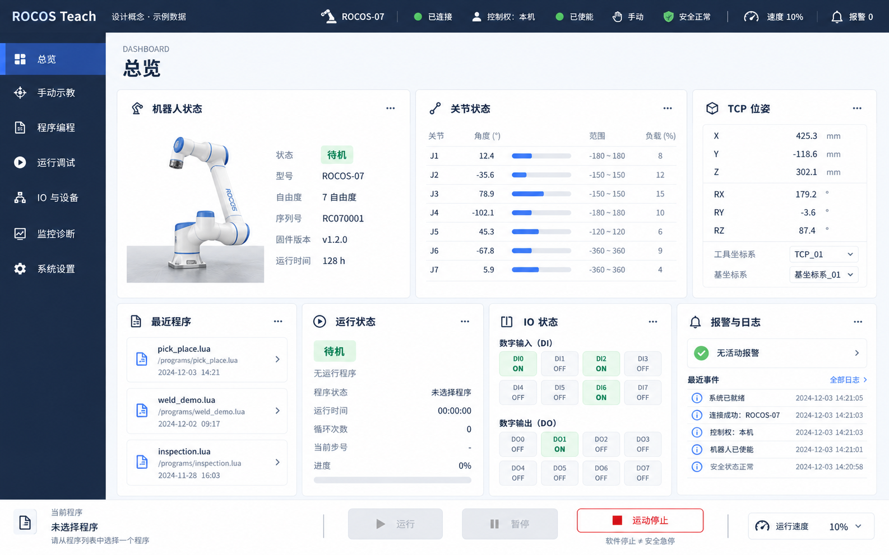
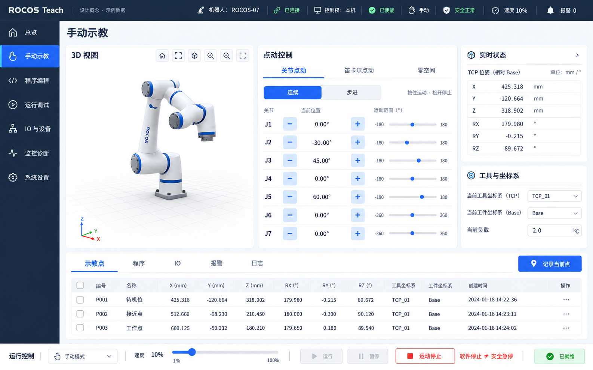
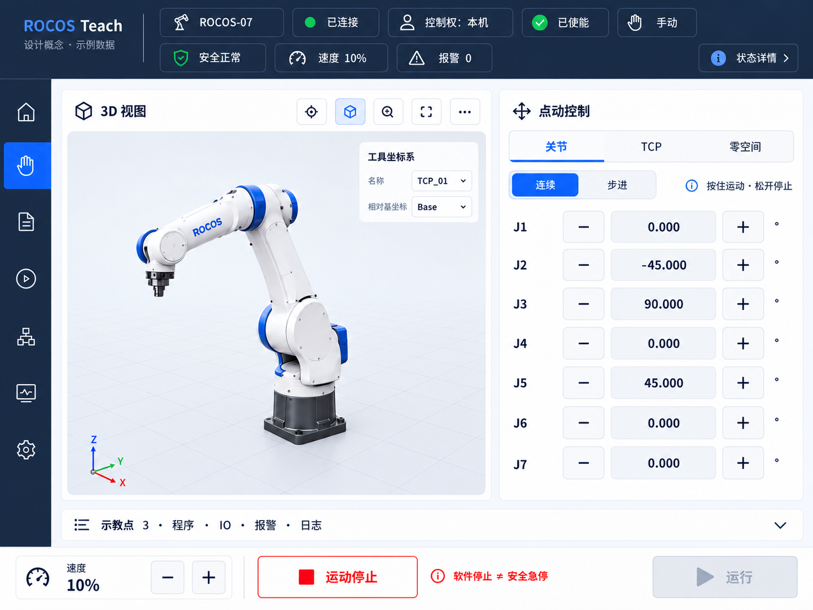

# ROCOS Teach 软件视觉与布局设计规范

> **文档版本**：V1.1（沿用原文件名，补充视觉、动效与概念效果图）
>
> **更新日期**：2026-10-20
>
> **适用产品**：ROCOS Teach（基于 ROCOS-Viz 演进）
>
> **文档性质**：视觉与布局设计基线；未标注“已定稿”的细节为后续设计建议。
>
> **设计基准**：1920 × 1200（16:10）；适配桌面浏览器、工业触摸屏及 Pad。

**本次补充**：第 4 节细化蓝灰科技风与浅色主题；第 8.1–8.4 节定义 Anime.js 动效和控制交互边界；第 12 节提供三张待确认的概念效果图。原有已定稿信息架构保持有效，新增视觉细节标为推荐方案，不代表用户已确认或产品已实现。

## 1. 设计目标与原则

ROCOS Teach 定位为集**机器人状态查看、手动示教、程序编程、运行调试、IO 与设备、监控诊断、系统配置**于一体的示教平台。

1. **卡片化与模块化**：所有主要功能通过独立的圆角矩形卡片组织，每张卡片有明确标题、内容区域和上下文操作。
2. **操作优先，状态常驻**：突出当前任务的操作控件；连接、控制权、使能、模式、安全状态及报警信息始终可见。
3. **3D 按需呈现**：三维视图是核心卡片之一，但不强制占据所有页面的主体空间。
4. **一致的导航语义**：左侧一级 TAB 切换工作场景；卡片内二级 TAB 切换同类功能；底部快捷卡片切换辅助信息。
5. **响应式重排，而非整体缩放**：以 1920 × 1200 为默认设计基准，按照可用 CSS 视口宽度重新编排卡片。
6. **兼顾触控与安全**：适合鼠标、键盘和触摸交互；软件交互不得被当作硬件安全功能的替代品。

## 2. 已定稿的信息架构

### 2.1 一级导航：固定 7 个 TAB

| 序号 | 中文名称 | 英文标识 | 主要功能 | 建议的二级 TAB |
|---|---|---|---|---|
| 1 | 总览 | Dashboard | 机器人与系统摘要、常用入口 | 以信息卡片为主，不强制设置二级 TAB |
| 2 | 手动示教 | Teaching | 关节/TCP 点动及点位记录 | 关节点动、笛卡尔点动、零空间、示教点 |
| 3 | 程序编程 | Programming | 创建与编辑机器人程序 | 程序管理、图形化编辑、Lua 编辑、变量与点位 |
| 4 | 运行调试 | Execution | 执行、单步、轨迹预览及仿真 | 程序执行、单步调试、轨迹预览、离线仿真 |
| 5 | IO 与设备 | Devices | IO 及外部设备监控操作 | 数字 IO、模拟 IO、末端工具、外部设备 |
| 6 | 监控诊断 | Diagnostics | 运行数据、报警、日志 | 实时状态、数据曲线、报警记录、系统日志 |
| 7 | 系统设置 | Settings | 机器人、工具和系统配置 | 机器人参数、工具/工件坐标系、负载、阻抗、安全、网络、用户 |

**划分原则（已定稿）**：轨迹仿真归入“运行调试”；报警诊断与实时监控合并为“监控诊断”。二级 TAB 名称和数量可在详细设计阶段微调，不新增一级导航。

### 2.2 三层导航与切换方式

- **一级：左侧导航栏**。切换总览、示教、编程等完整工作场景。
- **二级：卡片顶部 TAB / Segmented Control**。在原位置切换同类功能，例如关节点动、笛卡尔点动、零空间点动；其余卡片及 3D 场景保持稳定。
- **快捷层：工作区底部辅助信息卡片**。候选内容固定为：**示教点、程序、IO、报警、日志**。切换辅助信息不跳出当前一级页面。

底部另设独立的**全局运行控制条**（参见第 3 节），它与“可切换辅助信息卡片”是两个不同区域，不应合并。

## 3. 全局布局规范

### 3.1 标准设计画布（已定稿）

- **默认画布**：1920 × 1200，比例 **16:10**。
- 此画布是**初始设计与验收基准**，**不是固定窗口尺寸**；不要把整个页面用 CSS `transform: scale()` 等方式缩放以适配其他屏幕。
- 响应式判断基于浏览器的 **CSS viewport**，不以设备物理像素作为断点。

### 3.2 全局区域

| 区域 | 默认规格 | 是否常驻 | 设计要求 |
|---|---|---|---|
| 顶部全局状态栏 | 高 64 px | 是 | 设备、连接、控制权、使能、模式、安全、速度、报警等关键状态 |
| 左侧一级导航栏 | 宽 200 px；折叠后约 64 px | 桌面/横屏常驻 | 图标 + 标题；折叠时显示图标及可访问的文本提示 |
| 主工作区 | 剩余空间，**12 列响应式 CSS Grid** | 是 | 根据一级 TAB 加载对应卡片组合 |
| 工作区底部辅助卡片 | 高度随视口和内容调整 | 按页面需要 | 示教点/程序/IO/报警/日志之间切换，支持折叠 |
| 底部运行控制条 | 高 72–80 px | 支持操作的页面常驻 | 运行、暂停、停止、速度及上下文快捷操作；状态无效时禁用并说明原因 |

**布局规则**：主工作区外围留白、卡片间距及卡片内边距分别设置；顶部状态栏与运动控制条的可见性优先于非关键内容。屏幕高度不足时，优先让卡片内部滚动或折叠辅助区域，不裁切操作控件。

### 3.3 全局状态栏信息

必须持续可见的项目：**连接状态、机器人设备、控制权归属、使能状态、工作模式、硬件安全状态、速度倍率、当前最高报警等级/数量**。时间、用户身份、快捷设置等次要信息可随宽度收敛到菜单内。

状态栏应区分“已连接 / 断开”“已使能 / 未使能”“控制权：本机 / 他端 / 无”“手动 / 自动”等，不能只依靠颜色表达状态。

## 4. 视觉设计规范

### 4.1 整体风格（已定稿）

- **深蓝色**顶部状态栏与左侧导航栏。
- **白色为浅色主题基底**；浅灰/浅蓝灰仅用于卡片间隔、次级容器及 3D 地面，形成白底上的层次。
- **白色圆角矩形卡片**承载主要内容。
- **蓝色强调**当前选中的 TAB、主要操作按钮和选中数据。
- 清晰分区、轻边框、克制的阴影，优先呈现数据与操作，而非装饰效果。
- 默认浅色工作区；保留深色模式扩展能力。

**本轮风格提案：蓝灰精密工作台（待确认）**。科技感来自规则网格、清晰的数据对齐、细线图标、蓝色选中态及简洁的机器人三维视图。界面采用平面化工业仪表风格，不使用霓虹描边、整屏网格、玻璃模糊、装饰扫描线或循环发光；信息密度服务于操作，不追求填满每个区域。深蓝导航保持原设计基线，浅色内容区以白色为视觉主体。

**设计依据与取舍**：使用仓库内 [ui-ux-pro-max](../.agents/skills/ui-ux-pro-max/SKILL.md) 检索设计系统，并针对工业仪表盘、减少动态效果和 React Effect 清理做补充检索。采纳 `Minimalism & Swiss Style` 的清晰层级及 `Data-Dense Dashboard` 的网格/数据组织建议；不采纳自动输出中的营销型 Hero/CTA 布局、绿色主强调色和远程字体。以下蓝灰配色是结合本项目需求制定的方案，不宣称是技能数据库直接给出的专属机器人配色。React 检索包含较新版本建议，本项目保持 React 18 的 `useEffect`/清理机制，不引入 React 19 专用 API。

### 4.2 视觉设计令牌

下表中布局值来自当前决策；未最终确认的颜色、阴影和细节令牌是**推荐初始值**，待 UI 实现时统一收敛。

| 令牌 | 初始值 | 说明 |
|---|---|---|
| `--color-nav` | `#192B45` | 深蓝导航背景，推荐值 |
| `--color-on-nav` | `#FFFFFF` | 导航主文字 |
| `--color-nav-muted` | `#CBD5E1` | 导航次级文字 |
| `--color-primary` | `#2563EB` | 主要蓝色强调；本轮替换原推荐值，改善白字按钮对比度 |
| `--color-primary-hover` | `#1D4ED8` | 鼠标悬停 |
| `--color-primary-active` | `#1E40AF` | 按下/激活 |
| `--color-on-primary` | `#FFFFFF` | 实色蓝按钮文字 |
| `--color-selected-bg` | `#EFF6FF` | 浅蓝选中底色，配主蓝文字及指示条 |
| `--color-page` | `#FFFFFF` | 浅色主题基底 |
| `--color-workspace` | `#F5F7FB` | 卡片间隔/分区背景，非大面积深色画布 |
| `--color-card` | `#FFFFFF` | 卡片背景 |
| `--color-surface-muted` | `#F1F5F9` | 次级区域、只读值容器 |
| `--color-border` | `#E2E8F0` | 卡片装饰分隔线，不单独承担控件辨识 |
| `--color-control-border` | `#64748B` | 需要靠边界辨识的输入框/操作控件 |
| `--color-text` | `#1F2937` | 主要文本，推荐值 |
| `--color-text-secondary` | `#64748B` | 次级文本，推荐值 |
| `--color-text-on-muted` | `#475569` | 浅灰/浅蓝容器中的次级文本，避免对比度下降 |
| `--color-success` | `#15803D` | 正常/成功文字与图标，配 `#F0FDF4` 底色 |
| `--color-warning` | `#92400E` | 警告文字与图标，配 `#FFFBEB` 底色 |
| `--color-danger` | `#DC2626` | 错误/停止动作，推荐值 |
| `--color-danger-bg` | `#FEF2F2` | 错误提示底色 |
| `--color-danger-text` | `#B91C1C` | 浅红提示底上的错误文字 |
| `--color-disabled-bg` | `#F1F5F9` | 禁用背景；配 `--color-text-on-muted` 与显式原因 |
| `--color-focus` | `#2563EB` | 键盘焦点环，2 px 实线、2 px 间隔 |
| `--shadow-card` | `0 2px 8px rgb(25 43 69 / 4%)` | 静态卡片轻阴影；不做悬浮抬升 |
| `--shadow-overlay` | `0 12px 32px rgb(25 43 69 / 14%)` | 抽屉/弹窗层级 |
| `--radius-card` | `12px` | 卡片圆角，已定稿 |
| `--radius-control` | `8px` | 按钮/输入框；状态标签可用胶囊形 |
| `--gap-card` | `12px–16px` | 卡片间距，已定稿范围 |
| `--padding-card` | `16px–20px` | 卡片内边距，已定稿范围 |
| `--font-family` | `'AlibabaPuHuiTi'` | 强制约束：统一加载 `public/fonts/` 下的本地字体，字重映射见 4.4 |
| `--font-body` | `13px–14px` | 保留桌面紧凑数据字号范围；默认取 14 px，触控正文见 4.4 |
| `--font-data` | `16px–20px` | 关键数据显示字号，已定稿范围 |
| `--touch-target-min` | `44 × 44 CSS px` | 触摸目标下限；优先设计为 `48 × 48 CSS px` |

**字体统一为强制约束**：所有 UI 文本统一使用 [public/fonts/](../public/fonts/) 下的 **AlibabaPuHuiTi**，不按语言、页面或数据类型切换字体。关键数值可启用该字体自身支持的等宽数字特性；角度、长度、速度、力矩均需显式显示单位。图标配合文本/Tooltip 使用，不能只凭颜色判断状态。

**颜色使用约束**：蓝色表示选择、焦点和常规主操作，不表达“机器人安全”；绿色只表达已确认的正常/成功状态，琥珀色表达警告，红色表达故障和停止。断线/未知必须显示文字，不沿用最后一次绿色状态。普通文本与底色对比度目标 ≥ 4.5:1，必要的控件边界、状态图标和焦点指示目标 ≥ 3:1；低对比度装饰分隔线不能成为唯一状态提示。

按不透明 sRGB 色值计算：白字/主蓝约 **5.17:1**，主文字/白底约 **14.68:1**，次级文字/白底约 **4.76:1**，成功文字/浅绿底约 **4.79:1**，警告文字/浅黄底约 **6.84:1**。`#64748B` 不作为浅灰容器的普通正文色，`#DC2626` 不作为浅红底的普通正文色，分别使用专门的 `--color-text-on-muted` 与 `--color-danger-text`。实现中的透明叠加、Hover 和禁用状态仍需按最终背景检查。

### 4.3 卡片组件统一规则

1. 每张卡片由**标题栏、内容区、可选工具栏/操作区**组成。
2. 同类数据使用统一的标签、单位、对齐方式；数值实时更新时避免布局抖动。
3. 支持卡片内 TAB、展开/折叠、有限的尺寸调整；首次进入页面采用系统推荐布局。
4. 辅助卡片允许切换与折叠，**运动控制卡片不允许因自由拖拽而意外隐藏或遮挡**。
5. 重要错误和失联提示不得被卡片滚动或 3D 遮挡。
6. 3D 卡片支持放大/全屏，但必须保留必要的运行与安全状态可见性。

### 4.4 字体、密度与间距（字体为强制约束，其余为推荐方案）

**字体来源与覆盖范围（已确认约束）**：仅使用仓库 `public/fonts/` 下的 AlibabaPuHuiTi 本地字体文件，通过 `@font-face` 统一注册为 `AlibabaPuHuiTi` 字体族；浏览器资源路径使用 `/fonts/...`。中文、英文、数字、单位、导航、表单、表格、代码编辑器及图表/Canvas/3D 中的文字标签均遵循此约束。Ant Design、CodeMirror、ECharts 等组件需显式继承或配置该字体，不保留各自默认的系统字体或等宽字体。

| 字重 | 本地文件 |
|---|---|
| 300 / Light | `AlibabaPuHuiTi-3-45-Light.ttf` |
| 400 / Regular | `AlibabaPuHuiTi-3-55-Regular.ttf` |
| 500 / Medium | `AlibabaPuHuiTi-3-65-Medium.ttf` |
| 600 / SemiBold | `AlibabaPuHuiTi-3-75-SemiBold.ttf` |
| 700 / Bold | `AlibabaPuHuiTi-3-85-Bold.ttf` |

禁止引入在线字体、其他字体家族或使用依赖包中的字体替代上述本地文件；需要不同强调程度时使用对应的真实字重文件。字体加载失败应作为资源缺陷修复，不将系统回退字体视为符合设计规范的交付效果。

| 元素 | 桌面建议 | 触控/Pad 建议 |
|---|---|---|
| 页面标题 | 24 px / 600 | 22–24 px / 600 |
| 卡片标题 | 16 px / 600 | 18 px / 600 |
| 正文与字段标签 | 14 px / 400 | 16 px / 400 |
| 按钮文字 | 14–16 px / 500 | 16 px / 500 |
| 关键数值 | 20 px；摘要 KPI 可用 28 px | 20–24 px |
| 次要时间戳/单位 | 12–13 px，不能用于关键状态 | 14 px |
| 数据行高 | 40–44 px；含操作时 ≥ 48 px | ≥ 48 px |
| 点动 ± 按钮 | 至少 48 × 48 CSS px | 优先 56 × 56，受限时不少于 48 × 48 |

- 正文默认使用 AlibabaPuHuiTi Regular，标题和操作标签按层级使用 Medium/SemiBold，正文行高建议 1.5。
- 数值可设置 `font-variant-numeric: tabular-nums`，并验证本地字体是否支持；若不支持，仍保持 AlibabaPuHuiTi，通过固定数值容器宽度、右对齐及独立单位列减少布局抖动，不改用其他等宽字体。标签左对齐；小数位由数据类型统一定义。
- 采用 4 px 基础间距阶梯：4 / 8 / 12 / 16 / 20 / 24 / 32。默认外围留白 20 px、卡片间距 16 px、卡片内边距 20 px；紧凑视口可降至 16 / 12 / 16 px。
- 同组触控目标之间保留至少 8 px。出现空间不足时先折叠次要数据、重排卡片或内部滚动，不降低点动目标尺寸。

### 4.5 控件与状态外观（推荐方案）

| 组件 | 默认/选中表现 | 交互要求 |
|---|---|---|
| 一级导航 | 深蓝底、浅色线性图标；选中项蓝底白字，附左侧指示条 | 图标 + 名称；折叠后保留可访问名称与当前页语义 |
| 二级 TAB | 白/浅灰容器；选中项浅蓝底、蓝字、指示线 | 切换保留焦点，不移动相邻运动控件 |
| 主操作 | 蓝底白字，用于“记录当前点”“保存”等 | 一个操作组只突出一个主操作；不把蓝色理解为运动许可 |
| 次操作 | 白底、深色文字、明确边界 | Hover/Pressed 使用浅蓝/浅灰底，不改变控件尺寸 |
| 点动按钮 | 明确的 `−` / `+` 及关节/轴标识 | 按下即时实色反馈；可访问名称如“J1 正向点动”；松开即处理停止 |
| 运动停止 | 红色边框/文字，配停止图标和完整文案 | 与运行/暂停保持位置稳定；显示“软件停止 ≠ 安全急停” |
| 状态标签 | 图标 + 文本 + 轻底色 | “已连接”“未使能”“安全未知”等文案不能被圆点替代 |
| 输入与选择 | 标签始终可见；焦点环、单位和错误提示明确 | 错误在字段附近说明；不只依赖 Placeholder |
| 禁用/等待 | 淡底、可读文字、禁用语义；等待显示“处理中” | 原因在旁边显示，触控不依赖 Hover；避免重复提交 |
| 空态/失联 | “暂无数据”或 `—`，说明原因与可用的恢复入口 | 旧值如保留必须标为“已过期”并附更新时间，不表现为实时值 |

图标优先复用项目 `@ant-design/icons` 的同风格线性图标，常规尺寸 20 px、导航 22–24 px。不混用 Emoji 或不同粗细的图标集。选中态、焦点态、按下态必须彼此可区分。

### 4.6 3D、表格与图表视觉

- 3D 卡片使用白至浅蓝灰背景、低对比地面网格和柔和接触阴影。机器人模型可保留真实材质；效果图中的白蓝模型仅示意，不能作为真实 URDF 外观要求。
- XYZ 轴保留明确字母与惯用轴色；这些色彩属于空间语义，不受“蓝灰为主”限制。网格仅存在于 3D 内，不铺满工作区。
- 表头浅灰、行间细线；选中行浅蓝底 + 左侧标识，Hover 不取代选中态。实时值刷新不播放数字翻滚动画。
- 曲线优先使用蓝色及可区分的辅助色，同时提供线型/点型、图例、单位和时间轴；不能仅用多种深浅蓝区分大量关节。

### 4.7 设计令牌落地约定

后续实现时在现有 `src/styles/theme.ts`、`src/styles/global.css` 中集中映射语义令牌与 Ant Design `ConfigProvider` 主题。组件读取统一颜色、圆角、间距与动效令牌，不逐页硬编码。中英文文案统一进入 `src/i18n/index.ts`，英文长标签需重新检查溢出。深色主题另行验证，本轮效果图仅供浅色主题确认。

## 5. 总览页面（Dashboard）

### 5.1 页面定位

总览是**信息中心**，回答“机器人现在是什么状态？当前执行什么任务？是否存在异常？”；以只读数据卡片和快捷入口为主，不堆放复杂运动控件。

### 5.2 默认卡片：7 张（已定稿）

| 卡片 | 核心内容 | 入口/交互 |
|---|---|---|
| 机器人状态 | 型号、自由度、设备缩略图、运行状态、控制模式 | 查看详情 |
| 关节状态 | 各关节位置、速度、力矩、状态 | 进入监控 |
| TCP 位姿 | X/Y/Z、RX/RY/RZ、参考坐标系 | 切换坐标系 |
| 最近程序 | 最近打开/修改的程序 | 打开程序 |
| 运行状态 | 当前程序、执行进度、运行时间 | 进入运行调试 |
| IO 状态 | DI/DO 状态摘要 | 进入 IO 与设备 |
| 报警与日志 | 当前报警、最近事件、报警等级 | 查看诊断 |

**1920 × 1200 推荐初始布局**：第一排是「机器人状态、关节状态、TCP 位姿」3 张卡片（各占 4/12 列）；第二排是「最近程序、运行状态、IO 状态、报警与日志」4 张卡片（各占 3/12 列）。可按实际内容高度配置卡片行高，不要求每张卡片强制等高。

### 5.3 页面行为

- 用户可折叠非关键卡片并记住布局偏好。
- 无连接时展示明确的断线状态和重连入口，不填充伪造的实时数值。
- 报警有显著提示，但不应让静态卡片成为执行危险运动的入口。

## 6. 手动示教页面（Teaching）

### 6.1 页面定位

手动示教是主要**操作工作台**，在同页内完成观察、点动、确认位置、选择工具/坐标系及记录点位。

### 6.2 默认卡片组合（已定稿）

| 区域 | 核心卡片 | 内容 |
|---|---|---|
| 上方左侧 | **3D 视图** | 模型、视角、TCP/坐标轴、轨迹、场景元素 |
| 上方中部 | **点动控制** | 关节/笛卡尔/零空间、连续/步进、速度倍率、± 操作 |
| 上方右侧 | **实时状态** | 关节、TCP、速度、力矩等可切换数据 |
| 上方右侧/下部 | **工具与坐标系** | 当前工具 TCP、工作坐标系、负载、参考系 |
| 下方工作区 | **底部辅助卡片** | 默认示教点列表，可切换程序/IO/报警/日志，与 2.2 保持一致 |

**1920 × 1200 推荐初始布局**：主区域按 12 列分配 **3D 视图 5/12、点动控制 4/12、实时状态及工具卡片 3/12**；底部设较宽的示教点列表卡片。点动卡片中的二级 TAB 在原位切换，3D 卡片不因切换而重置。

### 6.3 点动与示教点交互

- 点动模式：**关节点动、笛卡尔点动、零空间**。
- 关节数应从机器人模型/控制器动态获取，不把 7 自由度写死为通用 UI 前提。
- 关节卡片需显示角度、单位、限位/运动状态；笛卡尔卡片显示 X/Y/Z、RX/RY/RZ 及当前参考系。
- 连续/步进点动采用清晰的切换控件，速度倍率随时可见。
- 示教点列表支持记录、命名、查看、编辑、删除、预览及添加到程序；变更与真实运动分离确认。
- 原点/回零类操作须区分“回到用户示教位置”和“机械零位/回参考点”，避免概念混淆。

## 7. 响应式布局与 Pad 适配

### 7.1 布局断点（已定稿）

| CSS 视口宽度 | 推荐布局 | 响应策略 |
|---|---|---|
| `≥ 1600px` | 完整桌面 | 三列/多列卡片、展开侧边栏、完整状态栏 |
| `1200–1599px` | 紧凑桌面 | 缩小非核心宽度，必要时两列排布，部分信息折叠 |
| `900–1199px` | Pad 横屏 | 图标侧边栏、双列主卡片、减少同时显示的数据列 |
| `600–899px` | Pad 竖屏 | 单列为主、底部主导航、卡片纵向重排 |
| `< 600px` | 小屏查看 | 以状态查看为主，默认不开放运动操作 |

断点应结合高度、方向、浏览器缩放和实际容器宽度测试。某些 1920 × 1200 的高 DPI Pad 在浏览器中的 CSS 视口可能显著小于 1920 × 1200；因此不能通过物理像素判断它属于桌面布局。

### 7.2 适配优先级

1. 保证全局状态、安全信息和操作权限提示可见。
2. 手动示教优先保证 **3D + 点动**两个核心卡片的可用宽度。
3. 缩窄时按布局断点重排卡片，而不是压缩字体或把整个页面等比缩小。
4. 表格过宽时只在卡片内部横向滚动，并允许收起次要列。
5. Pad 竖屏使用底部一级导航；不得让导航、运行控制、辅助信息三个区域互相覆盖。
6. 控制按钮尺寸满足触控要求；不能把 Hover 设为关键操作的唯一入口。
7. 3D 不可用时，数值状态和控制 UI 仍应独立显示，按控制器许可决定是否允许操作。

### 7.3 本轮效果图中的 Pad 重排方案（待确认）

- 以 **1024 × 768 CSS px** 验证横屏：侧栏收为 64 px 图标栏，3D 与点动并列；实时状态移入“状态详情”抽屉，当前工具/参考系在 3D 内以摘要常显，辅助卡片默认折叠。
- 顶栏空间不足时允许从 64 px 增高为两行，重新计算内容高度；连接、设备、控制权、使能、模式、安全、速度、报警不得被收到二级菜单。用户、时间等次要项优先收敛。
- 低高度优先折叠辅助区域；点动列表可在自己的卡片内滚动，但不能在按住点动时因滚动/重排改变命中目标，取消交互须按第 8 节处理。
- Pad 竖屏底部导航建议显示“总览、手动示教、程序编程、运行调试、更多”五个入口，“更多”承载其余三个已定稿页面，七个场景仍可到达。导航、运行控制条分别占位，并预留 `safe-area-inset-bottom`，不可相互覆盖。该竖屏方案尚待单独效果图验证。

## 8. 全局交互、安全与状态反馈

- 使用**统一的控件禁用与原因提示**：未连接、未使能、无控制权、模式不符、控制器报警、安全条件未满足等情况应明确说明。
- 点动须符合“持续按住、释放停止”的交互语义；处理指针取消、窗口失焦、组件卸载、连接中断及控制权丢失，并在**控制器侧**实现独立超时停止保护。
- 运行、暂停、运动停止属于软件控制命令；**软件停止按钮不等于安全急停**。物理急停、三位置使能装置与安全回路依据设备风险评估实现。
- 运动相关的卡片不能被布局编辑模式意外关闭；不允许仅凭前端显示状态作最终运动许可判定。
- 报警至少区分信息、警告、错误；文字说明与图标同时出现；故障详情和复位条件由控制器真实状态决定。

### 8.1 动效定位与技术选择（推荐方案）

用户提供的 `https://animejs.com/` 对应 **Anime.js**，npm 包名为 `animejs`，本规范统一使用此名称（非 `animate.js`）。本次仅定义方案，不安装依赖或改动业务 UI。

建议采用 **CSS 基础反馈 + Anime.js 编排动效**：简单颜色/边框过渡交给 CSS；确有需要的内容进入、辅助抽屉、保存完成反馈可使用 Anime.js。拟按官方当前 v4 API 设计，以 React `useEffect` 与 `createScope({ root })` 限定作用域，卸载时 `scope.revert()` 清理；正式接入时确认版本并锁定依赖。参见 [Anime.js 官网](https://animejs.com/) 与 [官方 React 接入说明](https://animejs.com/documentation/getting-started/using-with-react/)（核对日期：2026-10-20）。

动画的作用是说明“选择切换、内容出现、保存成功”，不模拟机器人真实运动或安全状态。不得同时为同一元素的同一属性启用 CSS、Ant Design 内建过渡和 Anime.js 动画。

### 8.2 动效规格表

下表为本项目建议值，需在目标工业终端验证；不是库的默认参数。

| 场景 | 效果与幅度 | 时长/缓动建议 | 边界 |
|---|---|---|---|
| 普通按钮 Hover | 背景/边框颜色过渡 | 100–120 ms，ease-out | 仅支持 Hover 的设备；不放大控件 |
| 普通按钮按下 | 立即出现按下底色，释放后恢复 | 恢复 80–100 ms | 运动按钮释放反馈即时恢复，不等过渡 |
| 一级页面切换 | 非关键内容淡入，最多向上 4 px | 160–180 ms，`out(3)` | 状态栏、运动控件不参与；3D 不因动画重新挂载 |
| 二级 TAB | 选中指示条平移；内容可淡入 | 120–160 ms，`out(3)` | 几何位置和焦点稳定；不播放整页退场 |
| 辅助抽屉 | 容器从边缘移动 12 px 并淡入 | 进入 200 ms，退出 140 ms | 布局空间预留；处理焦点进入、返回及 Esc |
| 辅助卡片展开 | 布局先到最终尺寸，内部内容淡入 | 160 ms | 不逐帧动画 width/height，不挤动点动控件 |
| 记录示教点成功 | 对应新行一次浅蓝强调后恢复 | 240 ms | 成功应来自实际保存结果；失败显示错误 |
| 数据加载 | 延迟显示静态骨架/文字，必要时普通加载指示 | 等待超过 200 ms 才显示占位 | 不做全屏闪烁；不能延后真实结果显示 |
| 报警、断线、权限变化 | 立即更新图标、文字和背景 | 无进入延迟 | 禁止闪烁、排队淡入或自动淡出关键提示 |
| 实时关节/TCP/曲线 | 直接显示最新有效状态 | 不做数值插值动效 | 3D 的数据插值由渲染层单独定义，不能由 UI 动画伪造 |

推荐令牌：`--motion-fast: 120ms`、`--motion-normal: 180ms`、`--motion-overlay-in: 200ms`、`--motion-overlay-out: 140ms`。普通 CSS 缓动可使用 `cubic-bezier(0.2, 0, 0, 1)`；Anime.js 的 `ease: 'out(3)'` 是相近用途的选择，不要求两者曲线完全相同。同一视口同时只强调 1–2 个元素，不使用循环装饰、弹跳、弹簧过冲或整页级联延迟。

### 8.3 运动交互与动画隔离

1. `pointerdown`、释放、`pointercancel`、失焦、失联及控制权变化由原有控制链路处理；不能将运动命令、停止命令、心跳或许可判断放在动画完成回调中。
2. 点动与停止按钮不做位移、缩放、退场或延时禁用。正在按住点动时不允许通过动画更换按钮位置；离开页面、切换模式或失去上下文必须触发既有停止/清理流程。
3. 发送中与控制器确认后的状态必须区分；不得因“成功动画已播放”就把未确认请求标成成功，也不得因动效未结束而拒绝处理新状态。
4. 快速重复切换时取消旧动效并呈现最新目标，不排队播放过期状态。避免透明旧面板继续接收事件；只允许当前可见交互区域参与焦点和点击。
5. 动画关闭、库加载失败、页面隐藏或低性能降级时，核心 UI 与运动控制保持可用；功能不能依赖动画实例存在。

### 8.4 减少动态效果、生命周期与性能

- 同时支持系统 `prefers-reduced-motion: reduce` 与产品内“减少动态效果”开关；任一开启即取消非必要位移、缩放和渐变动画，直接显示最终可读状态。用户在动画中途打开此选项时也应即时生效。
- React 18 StrictMode 下验证重复挂载/清理；Effect 只依赖页面/交互目标，不依赖每帧机器人遥测。组件卸载时清理动画、监听器和计时器，恢复最终样式及可访问状态。
- 优先只动画 `transform` / `opacity`；短小背景反馈可例外，但不动画大面积模糊、阴影和布局尺寸。3D 画布不因卡片淡入创建新 WebGL 上下文。
- 在目标工业触摸屏上检查 3D 与动效并发时的输入响应，争取 60 fps；测量帧耗时、长任务和实际交互延迟，不能仅凭开发机流畅判定通过。性能不足时首先关闭装饰动效。
- 静态效果图只能确认构图与视觉，不证明动效时序、触控尺寸、性能和运动停止行为已验收；这些必须在可交互原型和设备联调中验证。

## 9. 推荐组件结构（实现参考，非定稿代码接口）

```text
AppShell
├── TopStatusBar                 全局状态
├── SideNavigation               7 个一级 TAB
├── PageContent
│   ├── DashboardPage
│   │   └── DashboardCards
│   └── TeachingPage
│       ├── Robot3DCard
│       ├── JogControlCard
│       ├── RobotRealtimeCard
│       ├── ToolFrameCard
│       └── ContextCardTabs     示教点 / 程序 / IO / 报警 / 日志
└── BottomControlBar             全局运行控制（按权限与状态启用）
```

建议优先复用现有 `RobotViewer`、`JointJogPanel`、`CartesianJogPanel`、`NullSpacePanel`、`FrameSelector`、`MotionControl`、状态 Store 及控制器 API 客户端；通过页面和卡片容器重组，而不是重写 3D 与通信基础层。

## 10. 设计与验收检查清单

- [ ] 七个一级 TAB 的名称、顺序和页面导航一致。
- [ ] 所有页面以 1920 × 1200（16:10）作为默认设计基准。
- [ ] 顶部状态栏、导航栏、底部运行控制条保持一致。
- [ ] 全局状态中的连接、使能、控制权、模式、安全和报警均明确可见。
- [ ] 主要功能由白色圆角卡片组织，卡片间距/内边距统一。
- [ ] 总览包含确定的 7 类信息卡片。
- [ ] 手动示教的默认主卡片为 3D、点动、实时状态、工具/坐标系；下方可切换示教点等辅助卡片。
- [ ] 在 1920×1200、1920×1080、1600×900、1440×900、1280×800、1024×768 及典型 Pad 横/竖屏 CSS 视口下检查重排。
- [ ] 不依赖整页缩放，不允许出现遮挡主要操作、字号过小或触摸目标过小的问题。
- [ ] 指针取消、失焦、控制权丢失和断线等场景的运动交互有明确处理。
- [ ] 显示的是控制器提供的真实状态；无数据时使用空状态，不伪造数值。
- [ ] 浅色主题为白色基底，蓝灰分区与深蓝导航一致；状态色没有被当作装饰色滥用。
- [ ] 普通正文对比度 ≥ 4.5:1，必要控件/焦点指示 ≥ 3:1，状态同时包含文本/图标。
- [ ] 桌面紧凑字号与 Pad 触控字号分别检查；中英文长文案、数值单位与焦点不被裁切。
- [ ] 所有 UI 文本使用 `public/fonts/` 下的 AlibabaPuHuiTi；字重文件加载成功，中英文、数值、编辑器与图表文字无其他字体混用。
- [ ] Hover、Pressed、Selected、Focus、Disabled、Loading、Error、Empty 等状态均有定义和实际表现。
- [ ] 开启“减少动态效果”以及动画中途切换该设置后，所有内容仍可读、可操作。
- [ ] 快速切换 TAB、组件卸载、StrictMode 重挂载不会残留动画、透明遮挡层或失效焦点。
- [ ] 停止、失联、报警和许可变化即时处理，与动画时长和完成回调无关。
- [ ] 3D 与 UI 动效并发、低性能设备及后台恢复场景经过测量；不以概念图代替功能验收。
- [ ] 第 12 节效果图的配色、密度、桌面布局和 Pad 重排方案分别取得确认，再进入实现。

## 11. 后续待细化事项

1. 卡片布局的用户自定义程度、拖拽能力和偏好保存粒度。
2. 暗色主题的完整配色表，以及本轮浅色图标/动效建议在真实终端上的验证。
3. 极窄屏幕是否启用只读模式及其权限规则。
4. 程序编程、运行调试等尚未详细设计页面的卡片尺寸和相互跳转流程。
5. 报警历史、IO、工具/工件坐标标定等功能与后端 API 的逐项对齐。
6. 第 12 节视觉提案确认后制作可交互原型，验证动效、英文文案、竖屏与高 DPI 场景。

## 12. 设计效果图与确认项（待确认）

以下三张图由内置 imagegen 按本规范生成，属于**视觉概念稿**，不是当前 ROCOS-Viz 截图或已完成的 UI。图中机器人、关节数、程序、点位及连接状态均为示例，不代表实际设备。生成图片中的文字、间距、按钮尺寸和数值可能有偏差；实现以本规范的令牌、布局和交互要求为准，不以位图测量值作为验收标准。

现有生成图不作为字体一致性的验收依据；后续可交互原型及正式 UI 必须实际加载上述本地 AlibabaPuHuiTi 字体，并以加载后的渲染结果验收。

生成提示词保存在 [image-prompts.json](assets/rocos-teach/image-prompts.json)，便于下一轮追踪修改。三张图采用同一浅色视觉方向，分别检查不同任务与视口，不是三个互斥皮肤。

### 12.1 方案 A：桌面总览

目标画布：1920 × 1200，16:10。重点确认深蓝全局导航、白色卡片、蓝灰背景层次，以及“上排三卡片 + 下排四卡片”的信息密度。

生成位图为 1586 × 992，接近 16:10；卡片宽度有生成偏差，正式布局仍按第 5.2 节上排各 4/12、下排各 3/12 实现。



确认项：白色主体是否足够明亮；蓝色强调是否适度；七类信息能否快速定位；总览是否保持信息中心而非复杂操作台的定位。

### 12.2 方案 B：桌面手动示教

目标画布：1920 × 1200，16:10。重点确认 3D / 点动 / 实时状态与工具卡片的 5:4:3 分配，下方辅助信息与独立运行控制条的层级。

生成位图为 1586 × 992，接近 16:10；图中点动区域略宽于目标比例，正式布局仍按第 6.2 节 5:4:3 分配并校验触控尺寸。



确认项：± 点动按钮是否醒目；工具/参考系是否易于确认；3D 大小是否合适；示教点列表是否挤占主操作；“运动停止”与硬件急停的区别是否明确。

### 12.3 方案 C：Pad 横屏手动示教

目标 CSS 视口：1024 × 768，4:3。重点确认图标侧栏、双列主卡片、辅助信息折叠和状态详情入口。它展示响应式重排意图，不是桌面图等比缩小。



确认项：关键状态是否常显；点动按钮是否便于触控；需要时是否容易进入状态详情；底部控制是否与辅助栏分开。实际尺寸与可用高度须按 7.3 节在浏览器验证。

### 12.4 本轮设计确认记录

| 决策 | 本轮推荐 | 确认状态 |
|---|---|---|
| 总体风格 | 蓝灰精密工作台；白底、深蓝导航、蓝色强调 | 待用户确认 |
| 强调色 | `#2563EB`，替换原 `#3178ED` 推荐值 | 待用户确认 |
| 视觉密度 | 桌面紧凑数据 + 触控控件放大 | 待用户确认 |
| 动效强度 | 120–240 ms 为主，关键控制/状态即时反馈 | 待交互原型验证及用户确认 |
| Pad 布局 | 双列核心区，次要状态抽屉化，辅助区折叠 | 待用户确认 |

下一轮可按“图号 + 区域 + 希望调整的方向”反馈，例如“B：点动区更宽”“A：导航颜色更浅”。确认前不将新增颜色和动效建议改标为已定稿。

---

**决策摘要**：**7 个一级 TAB、1920 × 1200 默认画布、卡片式浅色工作区、深蓝全局导航、三级切换机制、12 列响应式布局，以及总览/手动示教两页的初始卡片组合**作为当前设计基线；本轮补充白底蓝灰科技风、语义化视觉令牌、Anime.js 动效边界和三张概念效果图，新增细节在用户确认和实际原型验证后收敛。
