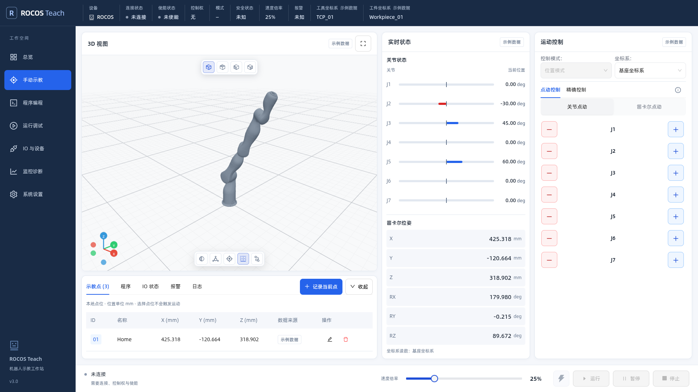
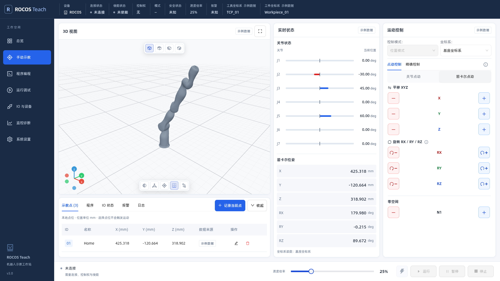
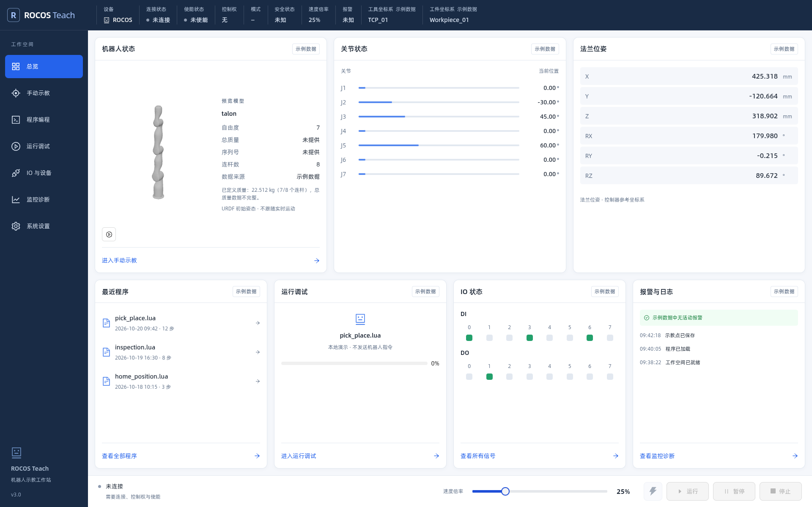
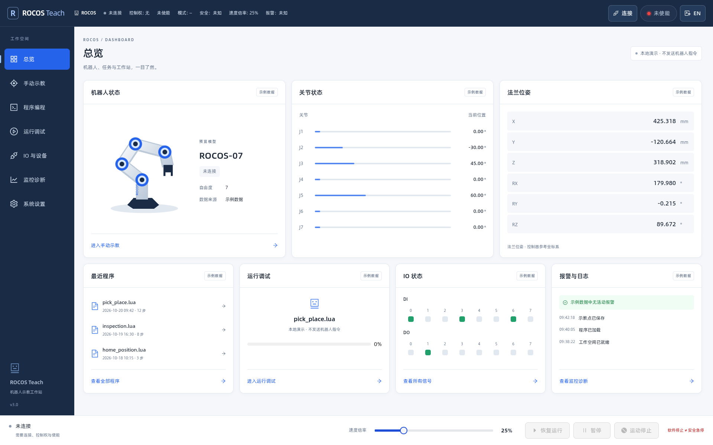
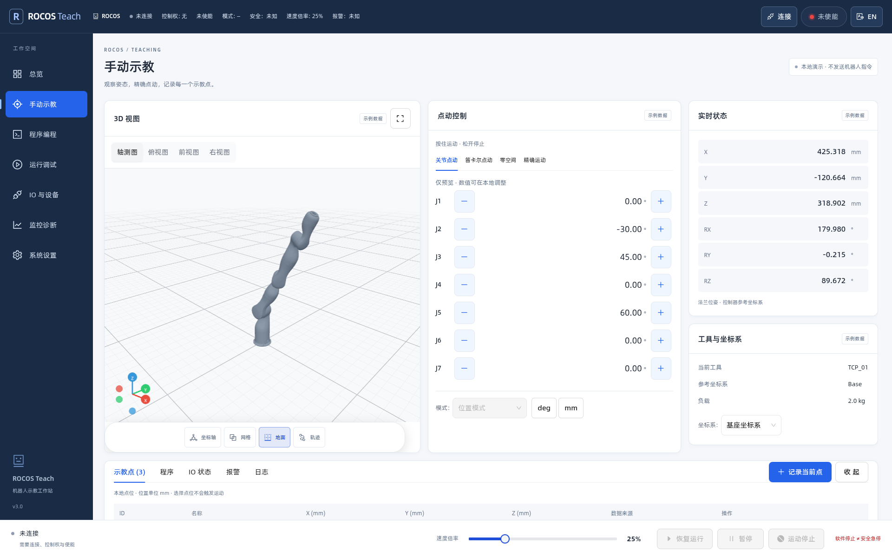
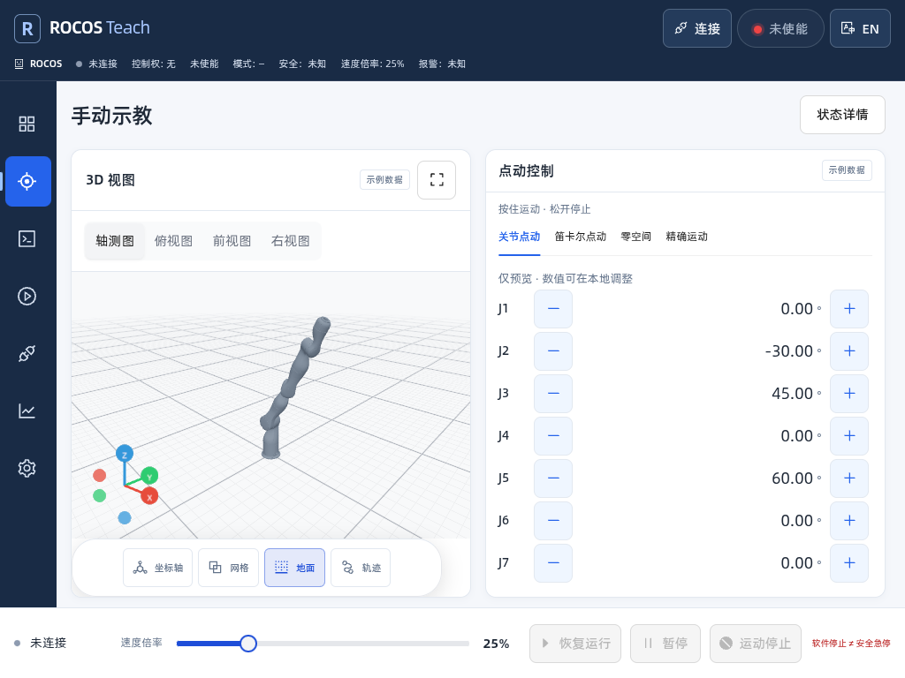

# ROCOS Teach UI 首轮实现

设计基线：[ROCOS_Teach_UI_Design_Spec_v1.0.md](ROCOS_Teach_UI_Design_Spec_v1.0.md)。本轮按内部测试提交，软件版本由 `3.0.0-rc.2` 更新为 `3.0.0-rc.3`，保留现有控制器接口。

## 运行与预览

使用 Node.js 20.19+，执行 `npm ci`、`npm run dev`。从 `/#/dashboard` 进入总览；首次打开无需控制器，即可浏览七个页面。连接参数通过“系统设置”中的“连接”按钮打开对话框配置。默认开发代理参数保持 `ROBOT_HOST`、`ROBOT_PORT`、`VITE_PORT`。

离线浏览时，所有真实控制命令禁用；示例程序、IO、点位及执行步骤都有标识。真实脚本操作位于“程序编程 → Lua 编辑”。“运行调试”当前用于确认本地示例交互，不执行控制器程序。

## 代码入口

- `src/components/teach/TeachShell.tsx`：路由、全局状态、导航及控制栏。
- `src/hooks/useControllerSession.ts`：原有连接、控制权和模型生命周期；切页持续运行。
- `src/components/teach/`：七个页面与共用卡片、场景、点位面板。
- `src/stores/teachStore.ts`：独立示例数据及本地草稿；不会污染实时状态。
- `src/styles/teach.css`：设计令牌、桌面/Pad/手机布局；`useMotionScope` 管理 Anime.js 生命周期。
- `src/core/HeldJog.ts` / `src/hooks/useHeldJog.ts`：串行点动与输入取消清理。
- `src/core/TelemetryBuffer.ts` / `src/hooks/useTelemetryCollector.ts`：独立采集环形缓存。
- `public/demo/talon/`：复用仓库已有 Talon URDF/STL 的离线示例，不需要请求控制器模型接口。

## 工作区布局

左侧导航贯穿窗口全高，顶部 Logo 是展开/收起按钮。展开/收起使用 240ms 平滑过渡，系统或应用开启“减少动态效果”时立即切换。收起后仅显示 Logo 图标与导航图标，图标支持提示文字；选择保存在本地，刷新和切页后保留。首次在窄屏进入时默认收起，手机上展开导航时覆盖部分工作区，避免挤压内容。

页面不再显示独立的标题、路径和描述区，卡片填充顶部状态栏与底部操作栏之间的可用高度。页面本身不滚动，长列表、编辑器及日志在所属卡片内部滚动。示教页由左至右为“3D 与示教点 / 实时状态 / 运动控制”，比例 6:3:3.2。示教点只在 3D 下方，收起仅改变 3D 高度；中间状态和右侧运动控制保持全高。关节和位姿区域按高度分配行间距，不出现滚动条，也不缩小字号。空间不足（工作区宽度不超过 1100 px 或窗口高度不超过 760 px）时，通过运动控制卡片内的“状态详情”打开读数抽屉；矮屏抽屉将关节和位姿并排展示。示教点工具栏上下保留 8 px 内边距，按钮统一为 44 px 高，该卡片宽度不足时使用带提示的 44×44 px 图标按钮。

工具坐标系和工件坐标系名称显示在全局顶部状态栏，在线名称来自控制器状态；离线名称带示例标记。手动示教不再单列“工具与坐标系”卡片。点动按关节、笛卡尔切换，零空间位于笛卡尔旋转点动下方，每行均为“负向红色按钮 / 轴名 / 正向蓝色按钮”，正负按钮保留符号、可访问名称和 48×44 px 尺寸；切换空间卸载原控件，复用 `useHeldJog` 清理以停止当前点动。笛卡尔空间通过共用的 `CartesianJogLayout` 上下显示平移 XYZ 和旋转 RX/RY/RZ，显示当前参考系并说明旋转观察方向；正向旋转图标按从正轴端朝原点观察的逆时针方向绘制。点动行不显示位置和姿态，读数集中到实时状态（窄屏通过状态详情抽屉查看）；离线预览按钮仅更新本地读数。

总览和实时状态共用 `JointReadout`。`JointRange.ts` 按名称解析 URDF 限位并计算零位刻线、正负色条；对称限位零位居中，不对称限位按比例定位。移动关节和旋转关节分别使用全局长度与角度单位。连续关节或缺失限位采用对称参考范围，悬停提示明确区分 URDF 限位与参考范围。零位不绘制虚假长度，负值红色、正值蓝色，超出显示范围时保留完整数值。该逻辑只改变显示，不修改控制协议或运动方向。

连接、断开及控制权接管入口集中在“系统设置”，中英文通过同页语言选择项切换，顶部状态栏仅显示信息。标题栏使用独立蓝灰配色：浅色主题为 `#E8EEF6` 配深色文字，深色主题为 `#2B405C` 配浅色文字，与 `#192B45` 侧栏区分；标签、分隔线及连接/使能状态色随主题适配。使能入口位于底部操作栏，采用闪电图标；绿色表示已使能，灰色表示未使能，悬停和键盘聚焦显示当前状态及操作提示。未连接、没有控制权或手机只读模式时禁止操作。

底部按钮统一显示“运行 / 暂停 / 停止”，停止采用实心正方形图标，移除右侧说明文字。“运行”沿用原有暂停状态下恢复运动的接口及权限检查。

布局回归覆盖桌面、Pad 和手机横竖屏，新增 1920×1080、1366×768 中英文/深浅主题的三列布局与点动按钮检查。下文同时保留早期截图，当前布局以最新截图和代码为准。

## 总览模型与统一字体

总览机器人卡片使用独立 `RobotOverview` / `RobotPreview` 加载模型：在线使用会话 URDF 和控制器网格接口，离线使用本地 Talon 示例。预览始终保持零关节初始姿态，绕自身包围盒中心的 +Z 轴每分钟旋转一圈，无地面和辅助轴。暂停按钮与减少动态效果设置均可停止自转；模型不订阅遥测关节角度，不发控制命令。模型加载失败可重试，卸载清理几何和材质。

名称、独立自由度、连杆数和质量来自 URDF。全部连杆都有有效质量才显示总质量；否则显示已定义质量与覆盖数，避免以零补齐缺失质量。序列号当前协议未提供，明确显示“未提供”。

字体层级规范见设计文档 §4.4：卡片/弹窗标题 16 px、卡内小标题及正文 14 px、辅助文字 12 px、关键数值 16 px；H1/品牌 20 px。`src/styles/typography.ts` 同时驱动 CSS 变量、Ant Design 和 Canvas/编辑器配置，中英文、主题与断点保持同层级同字号。已盘点七个页面、共用控制面板、弹窗、图表及编辑器，移除窄屏缩小卡片标题的规则。

## 3D 显示控件

场景上方居中显示轴测、俯视、前视、右视四个图标；下方居中显示半透明、坐标轴、关节轴、地面、轨迹五个开关。两组按钮均为 32×32 CSS px，浮动栏高度为 42px，支持中英文悬停提示与键盘聚焦提示。模型坐标轴使用加粗的实体箭杆与末端箭头，红、绿、蓝分别表示局部 X、Y、Z 正方向。

半透明开关将模型材质的不透明度设为原值的 30%，关闭后恢复原始材质设置。坐标轴与关节轴独立控制，不隐式改变透明度。关节轴使用 URDF 的关节局部 `axis`，直箭头表示轴正方向；旋转关节（revolute / continuous）另绘制按右手规则的正向旋转弧箭头，移动关节（prismatic）仅显示直箭头。固定及无单一运动轴的关节不绘制此标记。演示和在线模型共用 `RobotVisuals.ts`，加载完成后读取最新开关状态，卸载时清理订阅和辅助图形。

## 验证

```sh
npm run test:control
npm run test:script
npm run test:teach
npm run test:scene
npm run test:ui
npm run build
```

UI 回归默认启动或复用 `127.0.0.1:5188`，需要本机安装 Chrome。覆盖七页离线导航、预览操作不发送 `/api/` 请求、工程导出、语言切换、1920/1024/390 CSS px 布局、固定停止栏，以及 REST/WebSocket 拦截环境下的点动停止与会话持续性。截图保存在忽略提交的 `test-results/`。

待实机验证：控制器支持的运动/脚本状态枚举、断网及控制权失效时的设备停止行为、完整 URDF 加载、低性能 Pad 的 3D 与曲线并发性能。软件停止入口仍不是硬件急停。

本次总览模型与字体调整验证：控制心跳 6 项、脚本协议 7 项、点动及缓存 5 项、场景 2 项、既有浏览器 6 项及新增浏览器 5 项通过。新增回归覆盖 URDF 质量缺失、零关节与 mimic 初始姿态、相机适配、加载失败重试、中英文/主题/视口字号及弹窗标题。真实控制器数据通过 REST/WebSocket 拦截验证，未连接设备执行运动。

本次示教布局与点动调整：浏览器共 16 项通过，新增覆盖示教点收起对其他列无影响、正负按钮分离、关节零位、非对称/单侧/移动关节限位、参考范围，以及切换点动空间停止。控制心跳 6 项、脚本协议 7 项、点动及缓存 5 项通过；在线运动路径通过拦截接口验证，未连接真实机器人执行运动。

## 实际界面截图

当前手动示教（三列布局，示教点仅占 3D 下方，关节零位双向显示）：



笛卡尔点动（平移与旋转分组、负向与正向分开）：



当前总览（三维模型与统一字号）：




以下为浏览器实际渲染截图（离线示例状态），与设计规范中的概念图分开保存。







本轮验证结果：构建通过；控制心跳 6 项、脚本协议 7 项、点动及缓存 5 项、浏览器 5 项测试通过。新增与重构模块的定向 ESLint 检查及 `git diff --check` 通过。未连接真实控制器执行运动，未测量目标 Pad 的硬件性能。

## 控制模式、全局单位与直接连接

控制模式和参考坐标系统一放在点动/精确控制上方，运动控制列与状态列接近等宽。单位选项集中在系统设置的“单位显示”选项卡，角度/长度/力/力矩/质量逐行同时展示，蓝底白字标记选中项，持久化于 `rocos-units`。`Units.ts` 提供 SI 到显示单位的因子，`unitStore.ts` 统一驱动读数、点位表、模型质量、精确输入、监控曲线、CSV 及阻抗参数显示。阻抗的 N/m、N·m/rad、N·s/m、N·m·s/rad 按 API 文档组合换算；写入和 JSON 导入导出继续使用 API 单位。精确目标内部保存 SI 数值，切换单位只改变输入框显示。

系统设置单列“控制器连接”选项卡，内嵌 `ConnectionSettings`，带字段验证、连接等待及错误信息。提交后保存目标和 `autoLoadModel`，`useControllerSession` 据此决定是否请求 URDF。原模型加载勾选项未参与连接逻辑的问题已修正。控制权获取、心跳和断开处理继续由全局会话负责。

本轮验证：构建与定向 ESLint 通过；20 项浏览器回归已通过（包含更新后的直接连接流程），控制心跳 6 项、脚本协议 7 项、点动及缓存 5 项通过。新回归验证单位持久化、点位原值不变、阻抗组合单位、精确目标切换单位后的实际请求，以及模型自动加载开启/关闭。中英文、深浅主题和 1366×768 紧凑布局已检查；控制请求均使用模拟接口验证。

点动按钮行高改为 60 px，保留 44 px 按钮高度，相邻按钮净间距为 16 px。较矮窗口只滚动点动区域，保留控制模式和空间切换入口。零空间组件仍复用 `useHeldJog`，切回关节或离开示教页面会停止当前点动。

卡片留白统一由 `--teach-card-padding` / `--teach-card-header-padding-y` 控制：桌面内容 24 px、标题上下 16 px；紧凑窗口 20/14 px；窄屏 16/12 px。总览、3D、实时状态、运动控制、图表、设置及示教点共用该尺度，标题左右与内容对齐。标题栏仅移除最左侧设备字段的左分隔线。

卡片圆角通过 `--teach-card-radius` 统一设为 16 px，配合卡片内边距增加视觉留白；深浅主题及各视口使用相同圆角。

标题栏右侧增加 `HeaderAccount`：左侧用户选择框展示头像、用户名及权限，右侧显示本地日期和每秒刷新的时间。当前仅提供默认 `admin`（管理员）本地账号，尚未接入登录认证或服务器用户列表；该选择不影响控制器凭据和控制权。时钟独立更新，组件卸载时清理定时器；窄屏时账户与时间另起一行靠右展示。
